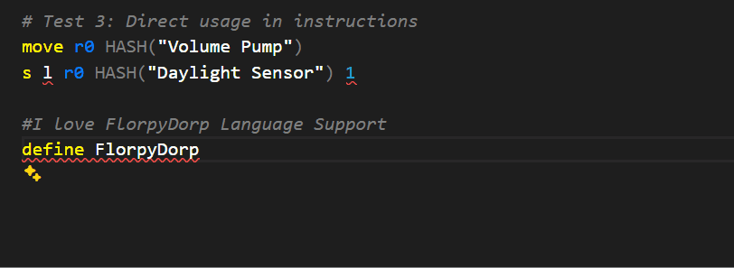
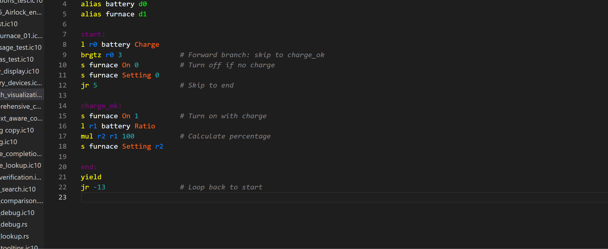
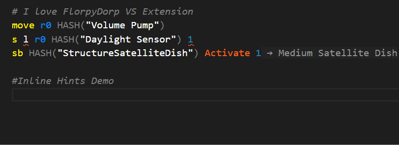
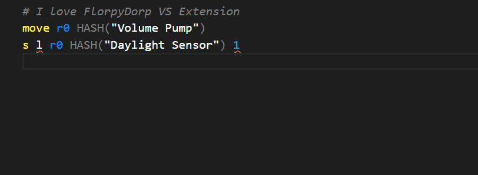
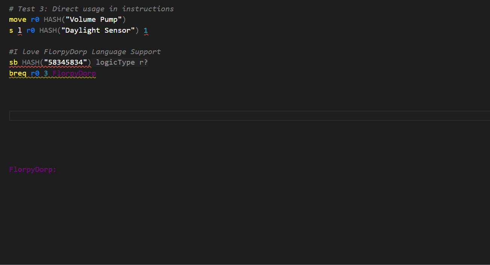
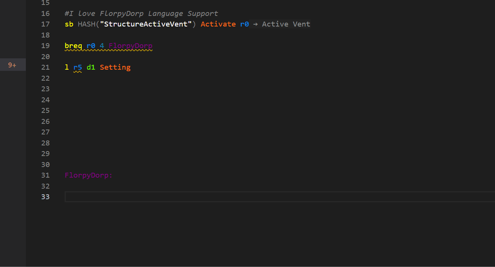
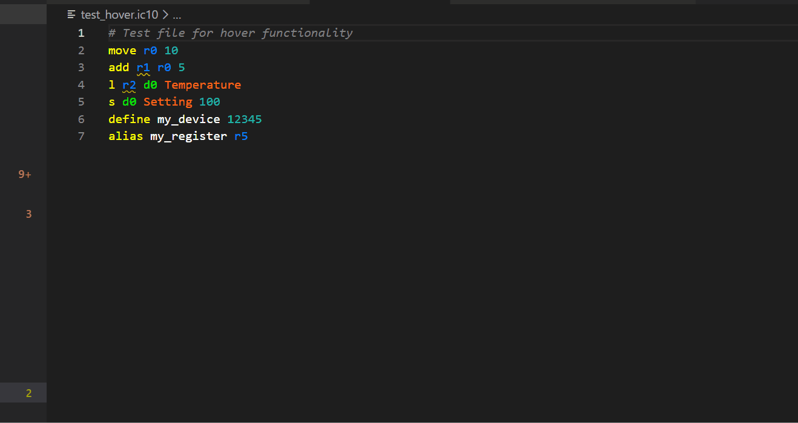
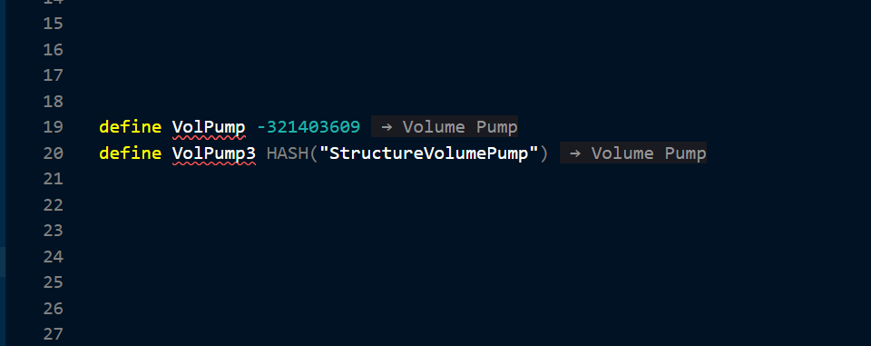
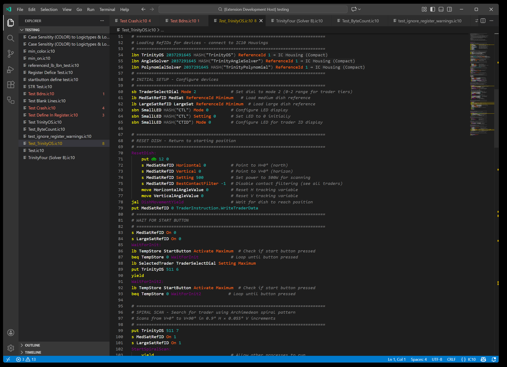
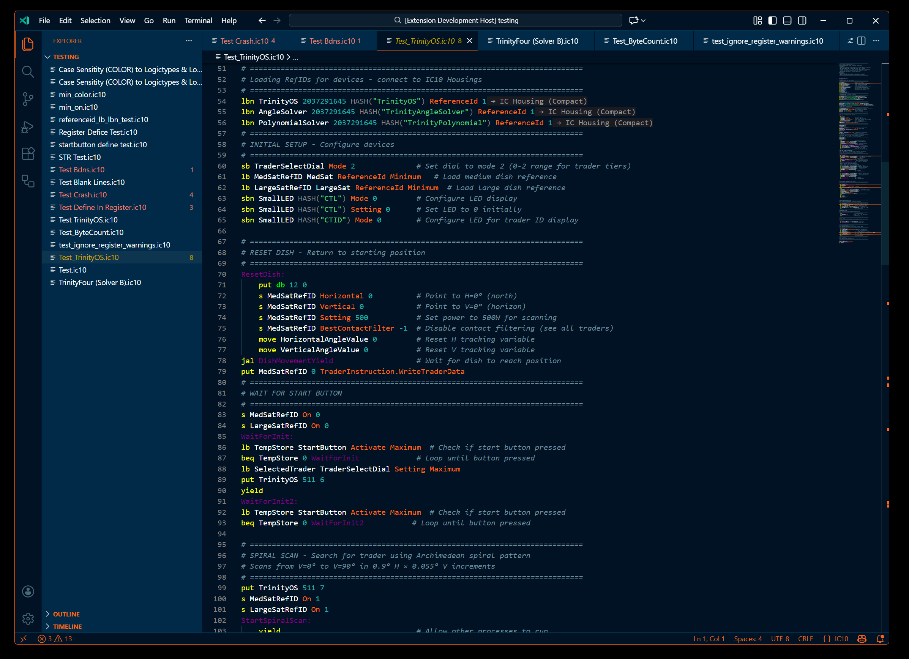

# FlorpyDorp IC10 Language Support  
================================

## Advanced IC10 editing, documentation, device hashing, and completion tools for Stationeers. 
### Code in STYLE!

 ### FlorpyDorp IC10 L.S. is a complete and actively maintained IC10 extension for VS Code. It provides deep IC10 language intelligence, rich hover documentation, expanded tokens, code diagnostics, device hashing tools, and quality-of-life enhancements built on years of community work.

---

## ☕Buy Me A Coffee....if you want.
While I genuinely do this for the love of the game and to support the community, if you're feeling feisty and grateful for this or my other tools for stationeers you can support my development efforts here:

☕[Buy This Man Coffee☕](https://buymeacoffee.com/florpydorp)

## ✨ Highlights

- Full IC10 syntax highlighting (`.ic10`)
- **Two immersive color themes**: IC10 In-Game Colors (syntax) and Stationeers Full Color Theme (full UI) with a hotkey to swap
- **Latest game support**: Updated for Stationeers Respawn Update Beta (v0.2.6054.26551)
- **Modular Console Mod**: Full support for all 101 modular console devices
- **13 new instructions**: atan2, pow, lerp, ext, ins, ld, sd, bdnvl, bdnvs, clr, clrd, poke, rmap
- **242 logic types**: Complete coverage including orbital mechanics and celestial navigation
- **1709+ device hashes**: Comprehensive device name resolution with HASH() tooltips
- **Every in-game hash represented!**: Directly pulled from the game files, this Extension has EVERYTHING.
- **Intelligent context-aware completions**: Dropdowns filter by parameter type
- **Device completions in HASH()**: All 1709 devices with fuzzy search
- **Usage-based sorting**: Frequently-used registers/devices prioritized
- **Blazing fast performance**: 86% faster diagnostics with intelligent caching
- **Device descriptions**: Hover over device hashes to see names and descriptions extracted from game files
- Multi-example hover documentation for 80+ instructions
- Expanded instruction descriptions and category grouping
- Instant diagnostics toggle (Ctrl+Alt+D)
- Theme toggle between Stationeers and your preferred theme (Ctrl+Alt+T)
- Inline device names from both `HASH()` and numeric hash values
- Inlay hints that avoid covering typed code (shadow text)
- Code length warnings approaching the 4096-byte IC10 limit
- Smart error detection (HASH() validation, relative branch warnings)

---

## 🚀 Intelligent Completions



The extension provides context-aware completions that understand what you're typing:

**Smart Filtering:**
- LogicType/BatchMode parameters show ONLY their predefined constants
- Register parameters show registers and your aliases
- Device parameters show device references
- Branch instructions show ONLY labels
- Batch instructions (lb, lbn, lbs) suggest HASH() for device parameters

**Device Completions in HASH():**
Type `HASH("")` and see all 1709 device names with fuzzy filtering:
- Example: `HASH("Struct")` shows StructureVolumePump, StructureBatterySmall, etc.
- Display format: `DeviceName → DisplayName (HashValue)`
- Case-insensitive search
- Only triggers inside HASH(""), not for completed calls

**Usage-Based Sorting:**
Completions prioritize items you've already used:
- Registers (r0-r17) that appear earlier float to top
- Devices (d0-d5) used in your code come first
- Your aliases and defines appear before unused items

**Automatic Triggers:**
- Space after instruction: Parameter completions appear
- Quote in HASH(): Device names appear instantly
- Empty LogicType/BatchMode: Dropdown shows automatically

---

## 🎯 Branch Visualization



Visualize control flow with color-coded branch indicators:

**Visual Indicators:**
- **Arrows**: ⇑ (upward) / ⇓ (downward) at branch source lines
- **Dots**: ● marking branch target lines
- **Color Coding**: Each branch gets a unique color (yellow, purple, cyan, orange, pink, lime)
- **Ghost Text**: Shows target line and code preview at end of source line
  - Example: ` ⇑ line 17: l r0 d0 On` (shows you're branching to line 17)

**Smart Highlighting:**
- **Source lines**: Lighter background (shows where branch originates)
- **Target lines**: Darker background (shows where branch lands)
- **Split highlights**: When multiple branches share a line, each segment shows correct opacity
- **Depth assignment**: Shorter branches appear leftmost, longer branches rightmost

**Perfect for:**
- Understanding complex loops and conditionals
- Debugging branch logic
- Visualizing state machines
- Learning IC10 control flow patterns

**Toggle on/off:**  
Press **Ctrl+Alt+B** to show/hide branch visualization anytime.

---

## 💡 Inlay Hints (Shadow Text)



See helpful context as you code without obscuring your text:

**Parameter Type Hints:**
- Shows expected parameter types as you type an instruction
- Example: Type `add` → see ` dest a b` in gray shadow text
- Disappears immediately when you start typing parameters
- Never interferes with cursor position or typing flow

**Device Name Hints:**



- HASH() calls show device display name and hash value at end of line
- Example: `HASH("StructureVolumePump")` → shows ` → Volume Pump (-1258351925)`
- Numeric device hashes show friendly names
- Example: `-1258351925` → shows ` → Volume Pump`
- Only appears for complete, valid device hashes
- Helps identify devices at a glance

**Smart Behavior:**
- Appears ahead of cursor, never covers what you're typing
- Updates in real-time as you write
- Helps learn instruction signatures and device names naturally

---

## 🩺 Error Detection & Diagnostics



The extension catches common mistakes:

**HASH() Validation:**
- `HASH("123")` shows error: "Cannot be a number. Use hash value directly: 123"
- Prevents putting numeric hash values inside HASH()

**Relative Branch to Label Warning:**
- `breq r0 0 labelName` shows warning: "Do you REALLY want to use relative branch here?"
- Quick-fix converts to absolute: `beq r0 0 labelName`
- Critical: Relative branches use the numeric value at the label, NOT the label's line number
- Prevents script-breaking bugs

**Code Limits:**
- Line, column, and byte-limit validation
- 4096-byte warning as you approach the IC10 limit
- Add `#IgnoreLimits` to suppress during development

---

## ⚡ Quick Actions & Refactoring



The extension provides intelligent code actions to improve your workflow:

**HASH Conversion Refactoring:**
- **String to Number**: Right-click on `HASH("StructureVolumePump")` → Refactor → "Convert to hash number: -1258351925"
- **Number to String**: Right-click on `-1258351925` → Refactor → "Convert to HASH(\"StructureVolumePump\")"
- Bidirectional conversion for all 1709 recognized devices
- Appears in "Refactor..." submenu (not quick-fix)

**Branch Conversion Quick-Fixes:**
- **Relative to Absolute**: `breq r0 0 label` → lightbulb → "Change to absolute branch (beq)"
- **Absolute to Relative**: `beq r0 0 123` → lightbulb → "Change to relative branch (breq)"
- Prevents common mistake of using relative branches with labels

**Register Diagnostic Suppression:**
- Click lightbulb on register diagnostic → "Ignore diagnostics for r0"
- Adds `# ignore r0` comment to suppress false positives
- Useful for complex control flow that static analysis can't follow
- Hotkey: **Ctrl+Alt+I** to suppress all register diagnostics at once

---

## 📚 Hover Documentation



Hover over any instruction to see:

- A category (Arithmetic, Control Flow, Device I/O, Batch Ops, etc.)
- A full description
- 3 or more examples (simple → intermediate → advanced)
- Syntax-highlighted IC10 code
- Related instruction references
- Register operation history for clarity

This turns the editor into a live IC10 reference.

---

## 🔢 Device Hash Support



The extension understands both string-based and numeric hash values for **1709+ devices** including the complete Modular Console Mod.

Features:

- **1709+ devices** from complete Stationpedia database (Respawn Update Beta)
- **Modular Console Mod**: All 101 devices including buttons, switches, dials, LEDs, gauges, and displays
- Hover tooltips for device names  
- Smart typo handling for common Stationeers prefab misspellings  
- `HASH()` in defines behaves exactly like a numeric constant  
- Inline hints show friendly device names instead of numeric hashes  
- A custom theme matching the colors of the game exactly!

---

## 🩺 Diagnostics & Code Tools

- Syntax validation for instructions, parameters, and registers  
- LogicType value tracking in registers for better type checking
- Line, column, and byte-limit validation  
- Unknown label/variable detection  
- Case-insensitive token resolution  
- Improved static parameter handling  

**Toggle diagnostics:**  
Press **Ctrl+Alt+D** to instantly clear squiggles and pause the language server.  
Press **Ctrl+Alt+D** again to restart it.

**Suppress register diagnostics:**  
When static analysis produces false positives for registers (common with complex jumps/loops):  
- **Manual**: Add `# ignore r1, r2` anywhere in your code  
- **Code Action**: Click the lightbulb on a register diagnostic → "Ignore diagnostics for rX"  
- **Hotkey**: Press **Ctrl+Alt+I** to suppress all register diagnostics at once

**Suppress hash diagnostics:**  
If you prefer not to see warnings about HASH() calls or device hash values:  
- **Hotkey**: Press **Ctrl+Alt+H** to toggle hash diagnostics on/off  
- Setting persists across VS Code sessions

**Suppress line/byte limit diagnostics:**  
For development or testing of large scripts that exceed the 128-line or 52KB limits:  
- Add `#IgnoreLimits` anywhere in your script (case-insensitive)  
- Suppresses "Instruction past line 128" errors  
- Suppresses byte limit warnings  
- Useful for prototyping before optimization

---

## 🎨 Color Themes

Choose from two custom themes designed for IC10 development:

### Stationeers IC10 Syntax Only
Perfect for users who want authentic Stationeers in-game syntax colors while keeping their familiar Dark+ UI. This theme only changes code colors, leaving the rest of VS Code untouched.



**Features:**
- Dark+ base UI (familiar and clean)
- Authentic Stationeers in-game syntax colors
- Optimized for IC10 instruction visibility
- Works seamlessly with existing VS Code setup

### Stationeers Full Color Theme
A complete immersive theme that transforms your entire VS Code interface with Stationeers-inspired colors throughout - code like you're in the game!



**Features:**
- Full custom UI colors inspired by Stationeers
- Cohesive color palette across editor and interface
- Deep integration with game aesthetics
- Complete visual overhaul

**Apply themes:**
- First install: Choose when prompted on activation
- Anytime: Press Ctrl+K Ctrl+T and select your preferred theme
- Toggle: Press **Ctrl+Alt+T** to switch between the full color Stationeers theme and your previous theme

---

## 🎩 Swap Themes with ease!
**Theme Toggle:**  
Press **Ctrl+Alt+T** to switch between the immersive Stationeers Editor Theme and your previous theme.

---

## ⚙️ Language Server Improvements

- Faster parsing and improved stability  
- Corrected tree-sitter query for `hash_preproc`  
- Updated startup sequence to use async `start()`  
- Safe restart behavior (no “stream destroyed” errors)  
- Inlay hints positioned away from the cursor  
- Expanded logic tokens including:  
  `ReferenceId, BestContactFilter, CelestialHash, EntityState, Apex, VelocityX, VelocityY, VelocityZ, Orientation, Density, TotalQuantity, MinedQuantity, Channel0–7`

---

## 📝 Usage & Hotkeys

1. Install the extension.  
2. Open or create a file ending in `.ic10`.  
3. Start typing — language features load automatically.
4. Profit

**Platform Support:**  
- ✅ Windows (x64)
- ✅ Linux (x64)
- ✅ macOS Intel (x64)
- ✅ macOS Apple Silicon (ARM64)

**Available Commands:**  
- Ctrl+Shift+P → "IC10: Restart Server" (restart language server)
- Ctrl+Shift+P → "IC10: Show Version" (display LSP version)
- Ctrl+Shift+P → "IC10: Show Related Instructions"
- Ctrl+Shift+P → "IC10: Search Instruction Category"
- Ctrl+Shift+P → "IC10: Show Instruction Examples"

**Hotkeys:**  
- **Ctrl+Alt+D** - Toggle all diagnostics (errors/warnings)
- **Ctrl+Alt+H** - Toggle hash diagnostics (HASH() and device hash warnings)
- **Ctrl+Alt+I** - Suppress all register diagnostics (adds ignore comments)
- **Ctrl+Alt+W** - Add #IgnoreRegisterWarnings directive
- **Ctrl+Alt+T** - Toggle Stationeers theme on/off
- **Ctrl+Alt+B** - Show/hide branch visualization anytime.

---

## 🧩 Instructions for Mods

Some mods add IC10 instructions. The extension learns them from an `ic10-instructions.json` file.

**Where it finds the files:**

1. **The mods enabled in your game.** The extension reads the game's `modconfig.xml`.
2. **`ic10-lint.json`** in your workspace: each package in its `"extensions"` list that names a file with `"ic10Instructions"` in its `package.json`.
3. **The VSCode `ic10.lsp.instructionFiles` setting**: any other files.

The file the first source gives wins; the **IC10 Mod Instructions** output channel lists where each
instruction came from.

**For mod authors:** ship `ic10-instructions.json` in your mod's folder. The extension's JSON schema
checks it as you edit. Its `"name"` shows in each instruction's hover, as "From the mod …".

```json
{
  "name": "Example Math",
  "instructions": {
    "avg": {
      "description": "Puts the average of a, b and (if given) c into r?.",
      "operands": [
        { "name": "dest", "type": "r?", "role": "write" },
        { "name": "a", "type": "r?|num" },
        { "name": "b", "type": "r?|num" },
        { "name": "c", "type": "r?|num", "optional": true }
      ]
    }
  }
}
```

| Field | Means |
| --- | --- |
| `type` | What the operand takes, as the game's help writes it: `r?`, `num`, `int`, `d?`, `logicType`, `slotLogicType`, `batchMode`, `reagentMode`, `str`, joined with `\|`. |
| `role` | `read` (the default), `write` (the register it sets: the first operand only) or `jump` (where it jumps to). |
| `optional` | It can be left off. Optional operands come last. |
| `flow` | `jump` (like `j`), `branch` (like `beq`), `call` (like `jal`), `return` (like `j ra`) or `halt` (like `hcf`). Leave it out for an instruction that runs on to the next line. |

---

## 🔧 Settings

You can customize behavior using these settings:

| Setting                  | Description                     | Default |
|--------------------------|---------------------------------|---------|
| `ic10.lsp.max_lines`     | Maximum allowed lines           | `128`   |
| `ic10.lsp.max_columns`   | Maximum columns per line        | `90`    |
| `ic10.lsp.max_bytes`     | Maximum total bytes             | `4096`  |
| `ic10.lsp.instructionFiles` | More `ic10-instructions.json` files (see Instructions from Mods) | `[]` |
| `ic10.stationeersFolder` | The game's `My Games/Stationeers` folder, if it isn't found | found |
| `ic10.useRemoteLanguageServer` | Use a remote LSP (dev only) | `false` |

---

## 🐞 Issues & Feedback

Report bugs or request features at:  
https://github.com/FlorpyDorp/Stationeers-ic10/issues

---

## ❤️ Credits

This project builds on the work of:

- Anexgohan — earlier IC10 extension foundations  
- Xandaros — original `ic10lsp` language server  
- awilliamson — the first IC10 VS Code IC10 extension  
- IC10 community contributors for instruction documentation, prefab mapping, and testing
